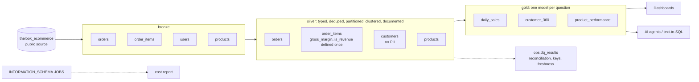

# BigQuery medallion + cost optimization demo

A small, runnable rebuild of the patterns I used for years on a large retail data platform:
raw data shared by many teams, `SELECT *` on unpartitioned tables, the same metric computed in
five places, and nobody sure which table to trust. This repo shows how I restructure that into
bronze → silver → gold, prove the cost difference, and keep it healthy with data quality and
cost monitoring.

It runs on public data (`bigquery-public-data.thelook_ecommerce`, a synthetic e-commerce store)
and fits in the free BigQuery sandbox. No billing account needed.

## Architecture



| Layer | Purpose | Rules |
|---|---|---|
| **bronze** | Land the source as-is | Audit columns (`_ingested_at`, `_source`) only. No business logic. |
| **silver** | One trusted version of each entity | Explicit columns, types, dedup (`QUALIFY ROW_NUMBER()`), partition by event date, cluster by join/filter keys, `require_partition_filter`, every column described. Calculated fields such as `gross_margin` and `is_revenue` live **only** here. PII is dropped. |
| **gold** | Answer a business question | Small, pre-aggregated, documented tables. The only layer dashboards and agents read. |
| **ops** | Keep it honest | Reconciliation bronze↔silver↔gold, orphan keys, freshness; cost report from `INFORMATION_SCHEMA.JOBS`. |

## Cost: same question, four ways

"Revenue per category in the last 30 days", measured with dry runs (`run.sh` prints this table):

| | Approach | Scanned |
|---|---|---|
| A | Report extract with `SELECT *` on raw tables, aggregated later in the BI tool | 22.1 MiB |
| B | Raw tables, only the needed columns | 6.5 MiB (3.4× less) |
| C | Silver: partition pruning + clustering | 1.0 MiB (22× less) |
| D | Gold: pre-aggregated table | < 0.05 MiB |

The point is not the absolute number (this dataset is small) but the ratio, which is what
drives a real bill at terabyte scale.

## Making the warehouse readable by AI agents

* Datasets, tables and columns all carry descriptions (`OPTIONS(description=...)`), so an agent
  can list the schema and pick `gold.*` first.
* Naming: `<layer>.<entity>`; dates as `*_date`, timestamps as `*_at`, money as `*_usd`.
* Metric definitions exist once (silver), so an agent can't compute "revenue" two different ways.
* Access can be granted per dataset: agents get `gold` only (authorized views or IAM on the dataset).

## Run it

Easiest in **Cloud Shell** (free, `bq` already installed):

```bash
git clone https://github.com/lucasnaldo/bigquery-medallion-cost-demo && cd bigquery-medallion-cost-demo
./run.sh <your-project-id>
```

Then open `sql/60_jobs_cost_report.sql` in the console to see what your own queries cost.

Sandbox notes: tables and partitions expire after 60 days and DML is not available, so every
step uses `CREATE OR REPLACE` and the quality checks compare the last 50 days. In a production
project the same SQL runs unchanged, scheduled through Dataform, Composer/Airflow or scheduled
queries.

## Files

```
sql/00_setup.sql            datasets per layer
sql/10_bronze.sql           raw landing
sql/20_silver.sql           clean, partitioned, clustered, documented
sql/30_gold.sql             daily_sales, customer_360, product_performance
sql/40_quality.sql          reconciliation, orphan keys, freshness -> ops.dq_results
sql/50_cost_demo.sql        the A/B/C/D comparison
sql/60_jobs_cost_report.sql top queries and tables by bytes billed
run.sh                      builds everything and prints the comparison
```
